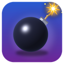
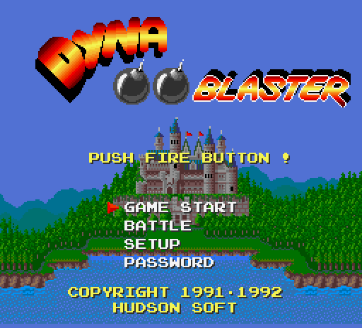
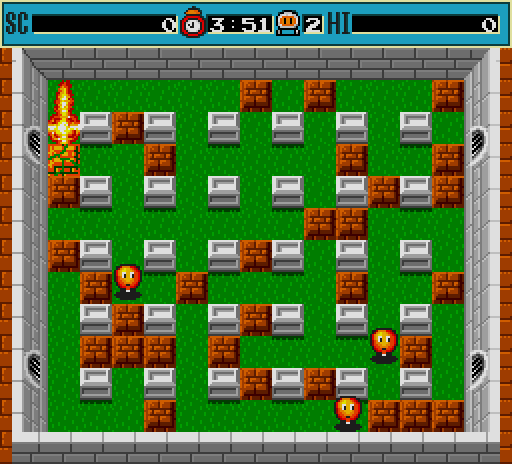
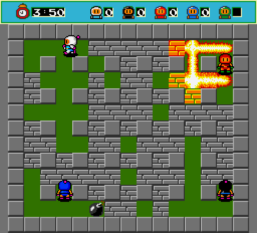
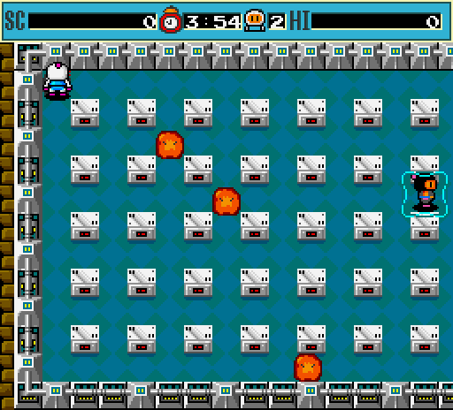

<p align="center"></p>

# Dyna Blaster

**English** | [Русский](README.ru.md)

The 1992 MS-DOS version of **Dyna Blaster** (Bomberman, Hudson Soft) rebuilt in Go
for today's computers: Windows, Linux and macOS on amd64 and arm64.

<p align="center">
  
  
</p>
<p align="center">
  
  
</p>

### Controls

The keys are the original ones and can be changed in the game (SETUP → REDEFINE KEYS).

| | Player 1 (keyboard 1) | Player 2 (keyboard 2) |
|---|---|---|
| Move | arrow keys | I, J, K, L |
| Drop a bomb | Space | A |
| Detonate (remote control) | Ctrl | — |

Other keys of the original game: **P** pauses, **Esc** leaves the game
(on the title screen it quits), **M** switches the music on/off,
**S** switches the sound effects on/off. Stage passwords are entered with the
cursor on the PASSWORD screen.

Keys of this edition (not passed to the game): **F11** or **Alt+Enter** —
fullscreen, **F12** or **Pause** — freeze the emulation.

Gamepads: the first two gamepads act as keyboard 1 and keyboard 2
(D-pad or left stick to move, bottom/left face button to drop a bomb,
right/top face button for the remote control). They follow the keys you set in
the game, so redefining keys does not break them.

### Command line options

```
-scale N            initial window size (N × 256x232, default 3)
-fullscreen         start in fullscreen mode
-smooth             bilinear filtering instead of sharp pixels
-nosound            run without audio (e.g. on a machine without a sound device)
-config DIR         where DYNA.CFG (your key setup) is stored
-interpret          use the reference x86 interpreter instead of the translated code
```

The setup saved with SETUP → SAVE SETUP is written to `DYNA.CFG` in the
per-user configuration directory (`%AppData%\DynaBlaster` on Windows,
`~/.config/DynaBlaster` on Linux, `~/Library/Application Support/DynaBlaster` on macOS).

## Building from source

Requires Go 1.25 or newer. No C compiler is needed for any target.

```sh
go build
```

## Legal

Dyna Blaster © 1991–1992 Hudson Soft; PC version published by Ubi Soft. The
game code in `game/` is a mechanical translation of the original program and,
like the original data files in `game/data`, belongs to its rights holders.
The platform code written for this edition (`machine`, `runner`,
`cmd`, `tools`) may be used under the terms of the MIT license. Make sure you
own the game before using or publishing this repository.
