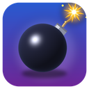
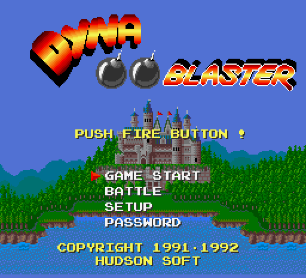
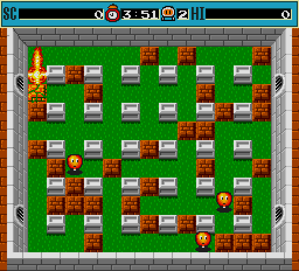
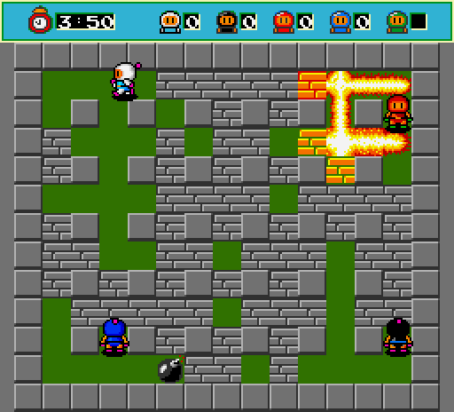
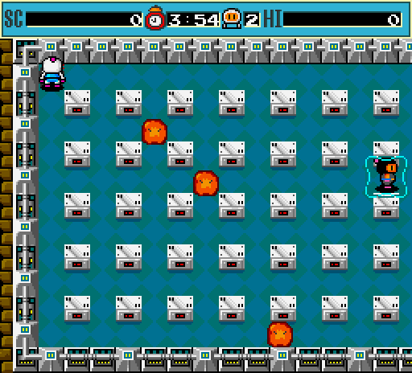

<p align="center"></p>

# Dyna Blaster

[English](README.md) | **Русский**

Версия **Dyna Blaster** (Bomberman, Hudson Soft) для MS-DOS 1992 года,
перенесённая на Go для современных компьютеров: Windows, Linux и macOS
на процессорах amd64 и arm64.

<p align="center">
  
  
</p>
<p align="center">
  
  
</p>

### Управление

Клавиши — как в оригинале; их можно переназначить в самой игре
(SETUP → REDEFINE KEYS).

| | Игрок 1 (клавиатура 1) | Игрок 2 (клавиатура 2) |
|---|---|---|
| Движение | стрелки | I, J, K, L |
| Поставить бомбу | Пробел | A |
| Взорвать (радиоуправление) | Ctrl | — |

Другие клавиши оригинальной игры: **P** — пауза, **Esc** — выход из игры на
титульный экран (на титульном экране — выход из программы), **M** — включить
или выключить музыку, **S** — включить или выключить звуковые эффекты.
Пароли уровней вводятся курсором на экране PASSWORD.

Клавиши этой версии (в игру не передаются): **F11** или **Alt+Enter** — полный
экран, **F12** или **Pause** — остановить эмуляцию.

Геймпады: первые два геймпада работают как клавиатура 1 и клавиатура 2
(крестовина или левый стик — движение, нижняя/левая кнопка — бомба,
правая/верхняя — радиоуправление). Они берут клавиши из настроек игры, поэтому
переназначение клавиш их не ломает.

### Параметры командной строки

```
-scale N            начальный размер окна (N × 256x232, по умолчанию 3)
-fullscreen         запуск в полноэкранном режиме
-smooth             билинейная фильтрация вместо чётких пикселей
-nosound            без звука (например, на машине без звукового устройства)
-config DIR         каталог для DYNA.CFG (настройки клавиш)
-interpret          использовать эталонный интерпретатор x86 вместо транслированного кода
```

Настройки, сохранённые через SETUP → SAVE SETUP, записываются в `DYNA.CFG`
в пользовательском каталоге настроек (`%AppData%\DynaBlaster` в Windows,
`~/.config/DynaBlaster` в Linux, `~/Library/Application Support/DynaBlaster` в macOS).

## Сборка из исходников

Нужен Go 1.25 или новее. Компилятор C не нужен ни для одной платформы.

```sh
go build
```

## Правовая информация

Dyna Blaster © 1991–1992 Hudson Soft; версию для PC издавала Ubi Soft. Код
игры в `game/` — механический перевод оригинальной программы и, как и
оригинальные файлы данных в `game/data`, принадлежит правообладателям.
Платформенный код, написанный для этой версии (`machine`, `runner`, `cmd`,
`tools`), можно использовать на условиях лицензии MIT. Используйте и
публикуйте этот репозиторий, только если у вас есть права на игру.
